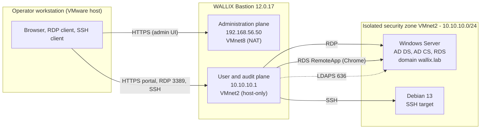

<div align="center">

<picture>
  <source media="(prefers-color-scheme: dark)" srcset="assets/logos/skillslab-white.png">
  
</picture>
&nbsp;&nbsp;&nbsp;&nbsp;


# Zero Trust Architecture with WALLIX Bastion (PAM)

**Brokered access to a Windows Server and a Debian host through a Privileged Access Management bastion, with encrypted directory authentication (LDAPS), isolated network zones, and three access paths: RDP, RDS RemoteApp, and SSH.**


-2E7D32?style=flat-square)


</div>

---

## Overview

This lab builds a small **zero-trust-style access architecture** around a **WALLIX Bastion**, a Privileged Access Management (PAM) solution. The principle is simple: **nobody connects to a target directly.** Every administrative session goes through the bastion, which authenticates the user, checks the authorization, proxies the session, and records it for audit.

| Access path | Protocol | Target | Result |
|---|---|---|---|
| **RDP** | Remote Desktop → Bastion proxy | Windows Server (`wallix.lab` domain controller) | Full desktop session, brokered and audited |
| **RDS** | RemoteApp via Remote Desktop Services | Google Chrome published from Windows Server | Only the application is streamed, not the whole desktop |
| **SSH** | SSH → Bastion proxy | Debian Linux | Terminal session with legal banner, brokered and audited |
| **LDAPS** | LDAP over TLS (port **636**) | Active Directory | Users imported and authenticated over an encrypted channel (plain LDAP is **not** used) |

All screenshots in this repository come from the actual lab, documented step by step in February 2026.

---

## Table of contents

1. [Architecture](#architecture)
2. [Lab environment](#lab-environment)
3. [Implementation walkthrough](#implementation-walkthrough)
   - [Phase 1: Isolated network zone and Bastion deployment](#phase-1-isolated-network-zone-and-bastion-deployment)
   - [Phase 2: Windows Server target](#phase-2-windows-server-target)
   - [Phase 3: Active Directory and PKI](#phase-3-active-directory-and-pki)
   - [Phase 4: LDAPS integration on the Bastion](#phase-4-ldaps-integration-on-the-bastion)
   - [Phase 5: Separating the administration and user planes](#phase-5-separating-the-administration-and-user-planes)
   - [Phase 6: Brokered access (RDS, RDP, SSH)](#phase-6-brokered-access-rds-rdp-ssh)
4. [Zero Trust principles demonstrated](#zero-trust-principles-demonstrated)
5. [Challenges and lessons learned](#challenges-and-lessons-learned)
6. [Production hardening: what I would change](#production-hardening-what-i-would-change)
7. [Repository structure](#repository-structure)
8. [Skills demonstrated](#skills-demonstrated)
9. [Author](#author)

---

## Architecture



### Addressing plan

| Component | Interface | Address | Network | Role |
|---|---|---|---|---|
| WALLIX Bastion | eth0 | `192.168.56.50/24` (gateway `192.168.56.2`) | VMnet8 (NAT) | Administration plane |
| WALLIX Bastion | second NIC | `10.10.10.1/24` | VMnet2 (host-only) | User and audit plane, gateway to the targets |
| Windows Server | NIC | static, `10.10.10.0/24` | VMnet2 only | Domain controller, CA, RDS host |
| Debian | NIC | static, `10.10.10.0/24` | VMnet2 only | SSH target |
| Active Directory | n/a | domain `wallix.lab` | n/a | Identity source, queried over LDAPS |

The targets live **only** on the isolated VMnet2 network. They have no other route in or out except through the Bastion.

---

## Lab environment

| Item | Detail |
|---|---|
| Hypervisor | VMware Workstation |
| PAM | WALLIX Bastion **12.0.17** (8 GB RAM, 2 vCPU, 50 GB disk) |
| Directory and PKI | Windows Server `WinServer-AD` (8 GB RAM, 2 vCPU, 60 GB disk): AD DS, AD CS, RDS |
| Linux target | Debian 13 (kernel 6.12) |
| Domain | `wallix.lab` |
| Client browser | Brave (Chromium) |

---

## Implementation walkthrough

### Phase 1: Isolated network zone and Bastion deployment

**1.1 Network segmentation.** A dedicated **VMnet2** host-only network (`10.10.10.0/24`) is created in the Virtual Network Editor. This is the isolated security zone that will hold every target.

<p align="center">
  <br>
  <em>VMware Virtual Network Editor: VMnet2 (host-only, 10.10.10.0/24) next to VMnet8 (NAT, 192.168.56.0/24)</em>
</p>

**1.2 Two network adapters on the Bastion.** The first adapter is attached to NAT (administration), the second to the custom VMnet2 (targets). This is what physically separates the admin plane from the user plane.

<p align="center">
  <br>
  <em>Bastion VM hardware: adapter 1 on NAT for administration, adapter 2 on VMnet2 for the target network</em>
</p>

**1.3 Automatic installation.** The Bastion 12.0.17 installer is booted and the automatic installation is selected.

<p align="center">
  <br>
  <em>Boot menu of the WALLIX Bastion 12.0.17 installation disk, automatic installation</em>
</p>

<p align="center">
  <br>
  <em>Installation complete</em>
</p>

**1.4 Initial configuration.** First boot of the Bastion console configuration wizard (the `wabadmin` and `wabupgrade` system accounts are used here; credentials are intentionally not published in this repository).

<p align="center">
  <br>
  <em>WALLIX Bastion initial configuration wizard</em>
</p>

**1.5 Static IP addressing and DNS.** `eth0` gets the administration address, and the target-facing interface gets `10.10.10.1/24` with no gateway (it is the gateway for the isolated zone). DNS is configured with the `wallix.lab` domain.

<p align="center">
  
  &nbsp;
  <br>
  <em>Left: admin interface <code>192.168.56.50</code>, gateway <code>192.168.56.2</code>. Right: target interface <code>10.10.10.1/24</code>, no default gateway</em>
</p>

<p align="center">
  <br>
  <em>Domain name <code>wallix.lab</code></em>
</p>

**1.6 First login and operational status.** The web interface is reachable and the admin password must be changed at first login.

<!-- TODO screenshot: assets/screenshots/01-bastion/10-bastion-login-page.png (WALLIX Bastion login page) -->

<p align="center">
  <br>
  <em>The Bastion forces a password change for <code>admin</code> at first login</em>
</p>

<!-- TODO screenshot: assets/screenshots/01-bastion/11-bastion-dashboard.png (Bastion web interface dashboard, successful deployment) -->

---

### Phase 2: Windows Server target

**2.1 Place the server on the isolated network.** The Windows Server VM has a single adapter on **VMnet2**, so it can only talk to the Bastion.

<p align="center">
  <br>
  <em><code>WinServer-AD</code>: single network adapter on the custom VMnet2 network</em>
</p>

**2.2 Static IP and gateway through the Bastion**, then **connectivity validation** (0% packet loss to the Bastion's target-facing interface).

<!-- TODO screenshot: assets/screenshots/02-windows/04-windows-ipv4-static-ip-via-bastion.png (IPv4 properties: static IP, gateway = Bastion) -->

<p align="center">
  <br>
  <em>Network validation: 4/4 replies from the Bastion at <code>10.10.10.1</code></em>
</p>

**2.3 Server roles.** Active Directory Domain Services, plus Remote Desktop Services with **Session Host** (user connections) and **Licensing** (CAL management).

<!-- TODO screenshot: assets/screenshots/02-windows/05-windows-ad-ds-server-roles.png (Select Server Roles, AD DS) -->

<p align="center">
  <br>
  <em>RDS role services selection: Remote Desktop Session Host and Remote Desktop Licensing</em>
</p>

---

### Phase 3: Active Directory and PKI

**3.1 Domain controller promotion.** A new forest named **`wallix.lab`** is created.

<!-- TODO screenshot: assets/screenshots/02-windows/06-windows-ad-ds-forest-wallix-lab.png (Deployment Configuration: new forest wallix.lab) -->

**3.2 Certificate Services (PKI).** Active Directory Certificate Services is deployed so the domain controller can serve **LDAPS** with a trusted certificate: install the role, configure it, name the CA, and confirm success.

<!-- TODO screenshot: assets/screenshots/03-ldaps/03-pki-adcs-installation-progress.png (AD CS installation progress) -->
<!-- TODO screenshot: assets/screenshots/03-ldaps/04-pki-configure-adcs.png (Click Configure Active Directory Certificate Services) -->
<!-- TODO screenshot: assets/screenshots/03-ldaps/05-pki-ca-name.png (Specify the name of the CA) -->
<!-- TODO screenshot: assets/screenshots/03-ldaps/06-pki-adcs-configuration-success.png (Configuration succeeded) -->

**3.3 Validate LDAPS on port 636.** `ldp.exe` is used to confirm an established SSL connection to Active Directory on port **636**.

<!-- TODO screenshot: assets/screenshots/03-ldaps/07-ldp-ldaps-636-connection-established.png (ldp.exe: Established connection using port 636 SSL) -->

**3.4 Trust establishment.** The **Root CA certificate is exported** so it can be imported into the Bastion, which lets the Bastion validate the domain controller's certificate chain.

<!-- TODO screenshot: assets/screenshots/03-ldaps/08-root-ca-certificate-export.png (Certificate Export Wizard) -->

---

### Phase 4: LDAPS integration on the Bastion

**4.1 Configure the Active Directory domain in LDAPS mode (port 636)** on the Bastion, using the exported Root CA as the trust anchor.

<!-- TODO screenshot: assets/screenshots/03-ldaps/09-bastion-ldaps-domain-configuration.png (Bastion: AD domain configured over LDAPS 636) -->

**4.2 Cipher compatibility fix.** To make the Bastion's LDAP client compatible with the Windows Server's cipher suites, the cipher policy had to be adjusted from the command line. In the Bastion's console security-level menu, the **LDAP client** level was changed to *Open-source community recommendations*, while every other service stays at **High**.

<p align="center">
  <br>
  <em>Security levels by service: HTTP admin, SSH proxy, RDP proxy, SMTP and Syslog stay <strong>High</strong>; only the LDAP client is adjusted</em>
</p>

**4.3 Trust chain validated and LDAPS authentication succeeds.**

<!-- TODO screenshot: assets/screenshots/03-ldaps/10-bastion-ldaps-authentication-success.png (LDAPS authentication success proof) -->

**4.4 Active Directory users mapped.** The Windows users are imported from AD over LDAPS into the Bastion.

<p align="center">
  <br>
  <em>Import users from LDAP/AD: the list of Windows users is populated through the LDAPS connection</em>
</p>

---

### Phase 5: Separating the administration and user planes

The Bastion's **Service control** page maps each service group to a specific interface:

| Service group | `eth0`: 192.168.56.50 (NAT) | `10.10.10.1` (VMnet2) |
|---|:---:|:---:|
| Administration features | ✅ | ❌ |
| User and audit features | ❌ | ✅ |

Administrators manage the Bastion from the NAT side; users and auditors only see the portal on the target side. The built-in Bastion firewall is enabled, with a limit of 30 parallel connections per IP.

<p align="center">
  <br>
  <em>System → Service control: administration on <code>192.168.56.50</code>, user and audit features on <code>10.10.10.1</code>. RDP, SSH and SSH admin services enabled</em>
</p>

<p align="center">
  <br>
  <em>The user portal served only on <code>10.10.10.1</code>, listing the three authorizations: <code>Secure_Browser</code> (APP), <code>AD</code> (RDP), <code>Linux</code> (SSH)</em>
</p>

---

### Phase 6: Brokered access (RDS, RDP, SSH)

#### 6.1 RDS: Chrome as a RemoteApp

Google Chrome is published as a **RemoteApp** on the Windows Server, with *Allow any command-line parameters* enabled so the Bastion can launch it. It is then declared in the Bastion as an application, with the RDS host as the target through an **alias**.

<!-- TODO screenshot: assets/screenshots/05-access/05-rds-remoteapp-allow-any-command-line-parameters.png (RemoteApp properties, Parameters tab: Allow any command-line parameters) -->
<!-- TODO screenshot: assets/screenshots/05-access/06-bastion-application-declaration-rds-alias.png (Bastion: application and target declared via RDS alias) -->

<p align="center">
  <br>
  <em>Chrome launched from the <code>Secure_Browser</code> authorization: only the isolated application is streamed to the user, not the server desktop</em>
</p>

<!-- TODO screenshot: assets/screenshots/05-access/07-rds-remoteapp-session-launched.png (second successful RemoteApp launch) -->

#### 6.2 RDP: Windows Server desktop

The RDP client opens a session named after the authorization (`AD-RDP-Authorization1_interactive_login_otp`) and connects to the **Bastion at `10.10.10.1:3389`**, never to the Windows Server itself. The Bastion then proxies the session to the target.

<p align="center">
  <br>
  <em>Remote Desktop session to <code>10.10.10.1:3389</code> (the Bastion proxy) landing on the Windows Server desktop</em>
</p>

#### 6.3 SSH: Debian

Launching the `Linux` authorization opens an SSH session through the Bastion. The legal banner is displayed, the target login is requested (interactive account), and the Debian shell opens. The "last login" line shows the connection source is **`10.10.10.1`**, the Bastion, and not the operator's workstation.

<p align="center">
  <br>
  <em>SSH session launched from the Bastion portal, before target authentication</em>
</p>

<p align="center">
  <br>
  <em>Debian 13 shell reached through the Bastion. Banner: actions may be recorded, retained and audited. Source of last login: <code>10.10.10.1</code></em>
</p>

---

## Zero Trust principles demonstrated

| Principle | How it is applied in this lab |
|---|---|
| **Never trust, always verify** | Every session requires authentication and a matching authorization on the Bastion before any target is reached |
| **No direct access to targets** | Targets sit alone on the isolated VMnet2 network; the only way in is through the Bastion |
| **Network segmentation** | Dedicated host-only zone for targets; NAT-side management network kept separate |
| **Plane separation** | Administration features on one interface, user and audit features on another |
| **Encrypted identity channel** | Directory queries use **LDAPS (636)** with a CA-signed certificate chain, never plain LDAP |
| **Least privilege and application-level access** | The RemoteApp path exposes a single application instead of a full desktop |
| **Visibility and accountability** | Sessions are proxied, and the banner informs users that actions are recorded, retained and audited |

---

## Challenges and lessons learned

- **LDAPS and cipher policy.** The Bastion's strict default cipher policy for the LDAP client had to be aligned with what the Windows Server offers. The approach: validate the certificate chain first (ldp.exe on port 636, Root CA import), then adjust the cipher level for **only the LDAP client** and leave every other service at High.
- **Trust is a chain, not a checkbox.** LDAPS only worked once the Root CA from AD CS was exported and imported into the Bastion.
- **RemoteApp needs command-line parameters.** Publishing Chrome as a RemoteApp is not enough: *Allow any command-line parameters* must be enabled so the Bastion can start the application.
- **Document as you build.** This repository started as a live build log (one screenshot per step), then was cleaned up into this write-up.

---

## Production hardening: what I would change

This is a lab, so some choices favour simplicity. In a real environment:

| Lab choice | Production approach |
|---|---|
| LDAP client cipher level relaxed to the open-source profile | Fix the Windows Schannel/TLS configuration (TLS 1.2+ with modern cipher suites) and keep the Bastion LDAP client at **High** |
| Bastion web UI on a self-signed certificate (browser shows *Not secure*) | Issue the certificate from the internal CA (AD CS is already deployed) |
| Interactive accounts: target credentials typed at connection time | Vault-managed credentials with automatic rotation, check-out and approval workflows |
| SSH target accessed as `root` | Dedicated non-root accounts, key-based authentication, `sudo` policy |
| Management plane on a NAT network | Dedicated management VLAN behind a firewall, with MFA for administrators |
| Single Bastion | High availability and remote log forwarding (SIEM/Syslog) |

---

## Repository structure

```text
.
├── README.md
├── .gitignore
└── assets
    ├── logos/                      # Program and vendor logos
    └── screenshots/
        ├── 01-bastion/             # Network zone, Bastion install and first login
        ├── 02-windows/             # Windows Server target, AD DS, RDS roles
        ├── 03-ldaps/               # PKI, LDAPS validation and Bastion integration
        ├── 04-segmentation/        # Admin vs user plane separation
        └── 05-access/              # RDS RemoteApp, RDP and SSH sessions
```

---

## Skills demonstrated

`Privileged Access Management (PAM)` · `WALLIX Bastion` · `Zero Trust architecture` · `Network segmentation (VMware)` · `Active Directory (AD DS)` · `PKI / AD CS` · `LDAPS (TLS, port 636)` · `Remote Desktop Services (RemoteApp)` · `RDP / SSH proxying` · `Linux (Debian) administration` · `Technical documentation`

---

## Author

**0xEmhddsi-Net** · Cyber Defense Administrator Trainee · Morocco
[GitHub: 0xEmhddsi-Net](https://github.com/0xEmhddsi-Net) · CompTIA Security+

Built during the **Skillslab by DataProtect** program, in partnership with **Jobintech**.

<div align="center">
  <picture>
    <source media="(prefers-color-scheme: dark)" srcset="assets/logos/dataprotect-white.png">
    
  </picture>
  &nbsp;&nbsp;&nbsp;&nbsp;
  
</div>

> **Disclaimer.** This is an isolated educational lab. IP addresses are private lab addresses and no real credentials, keys or certificates are included. WALLIX, DataProtect and Jobintech names and logos belong to their respective owners and are used for identification only.
